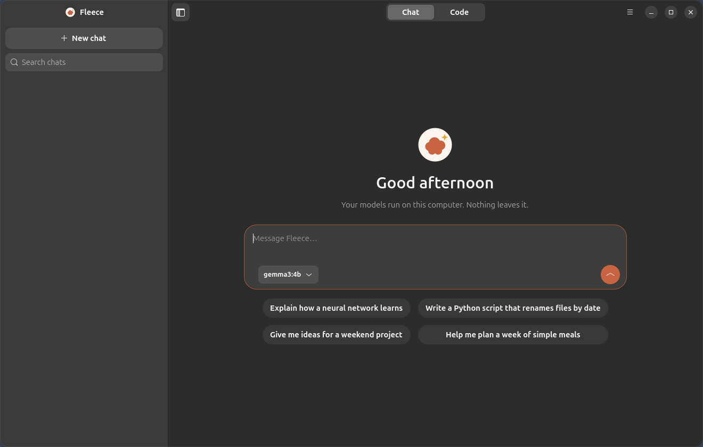
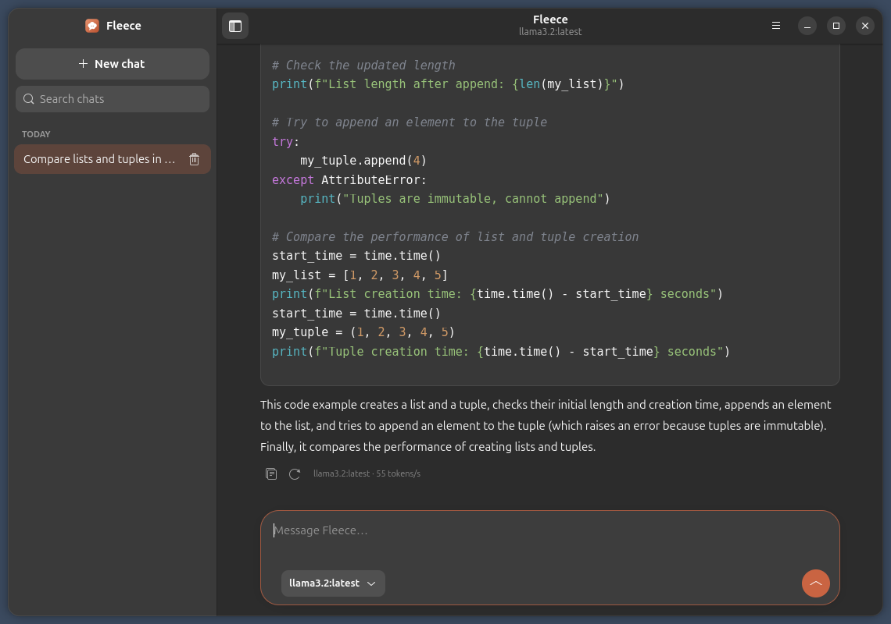
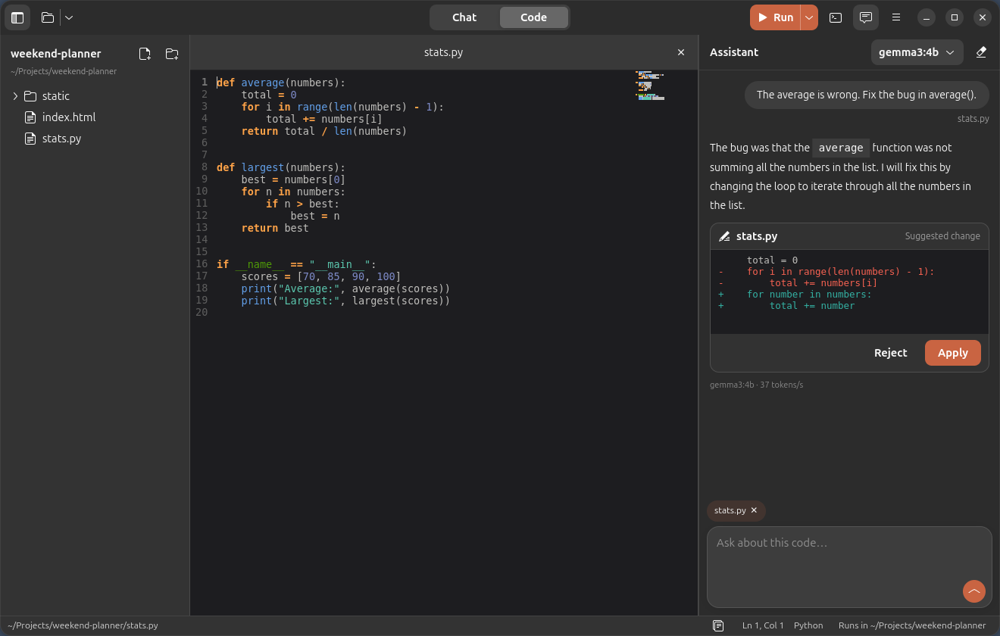
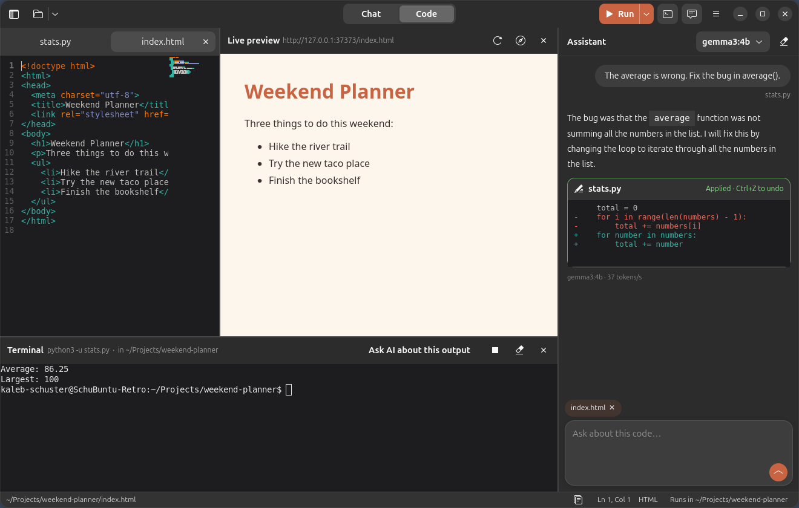
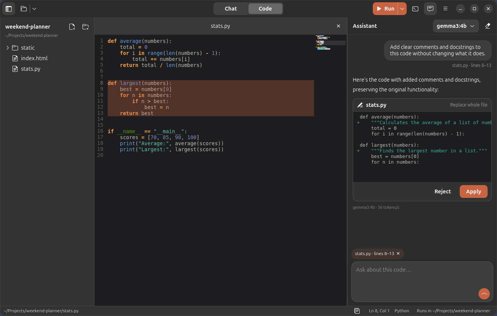
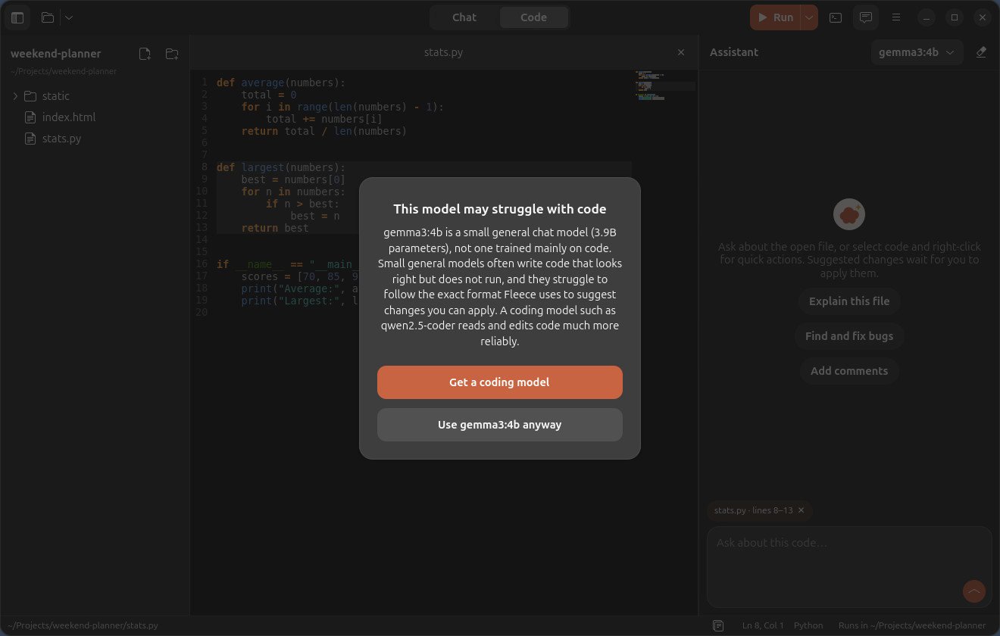
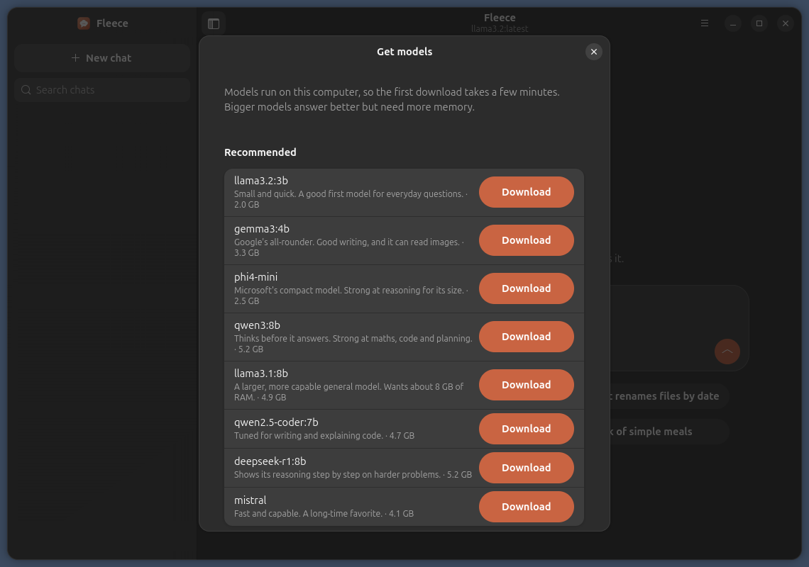
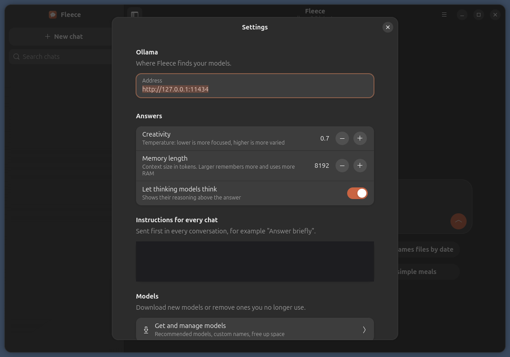

# Fleece

A chat window and a small AI coding workspace for your local [Ollama](https://ollama.com) models. Pick a model, type, and get streamed answers in a clean desktop app, with no terminal needed. Switch to **Code** to edit a project with an assistant that suggests changes you review and apply. Built with GTK 4 and libadwaita, so it fits Ubuntu.





## Code mode

Click **Code** at the top of the window and open a project folder.



- **A simple editor** in the spirit of Sublime Text: tabs, line numbers, highlighting, a minimap, find and replace (<kbd>Ctrl</kbd>+<kbd>F</kbd>, <kbd>Ctrl</kbd>+<kbd>H</kbd>) and **Go to file** (<kbd>Ctrl</kbd>+<kbd>P</kbd>).
- **Ask about the open code.** The assistant sees the open file, or just the lines you selected. The chip above the message box shows what it can see; click it to leave the file out.
- **Changes wait for you.** Suggested edits appear as cards with the removed lines in red and the new lines in green. Nothing changes until you click **Apply**, and <kbd>Ctrl</kbd>+<kbd>Z</kbd> undoes it. If the file changed since, the card says so instead of editing the wrong place.
- **Right-click a selection** to explain it, find and fix bugs, add comments, clean it up or write tests.
- **Run** (<kbd>F5</kbd>) does the right thing for the open file: Python and Node files run in the built-in terminal, `npm` scripts, `cargo` and `make` are offered in the Run menu, and web pages open in a **live preview** that reloads every time you save. **Ask AI about this output** sends errors to the assistant.
- **No mystery locations.** The project folder is shown above the file tree, the open file's full path is in the status bar, new files always ask where to save, and **Run settings** shows and changes the command and the folder Run starts from. Right-click any file to copy its path or show it in Files.





### Which model to use for code

Small general chat models, like `llama3.2` or `gemma3:4b`, can write code that looks right but doesn't run, and they often ignore the change format. The first time you use one in Code mode, Fleece explains this once and offers a coding model such as `qwen2.5-coder`. Choose **Use it anyway** and it won't ask again for that model.



## What it does

- **Chats like a modern assistant:** streamed answers, formatted text, lists, tables and highlighted code blocks with a copy button.
- **Switch models in one click** from the box where you type.
- **Download models without the terminal:** a recommended list with progress bars, or any name from the Ollama library.
- **Thinking models:** shows the reasoning above the answer, collapsed once the answer starts.
- **Keeps your chats** in a sidebar, grouped by day, searchable. They are plain files on your computer.
- **Settings:** creativity, memory length, instructions for every chat, and the Ollama address.
- Stop, copy and try-again buttons, and keyboard shortcuts: <kbd>Enter</kbd> sends, <kbd>Shift</kbd>+<kbd>Enter</kbd> adds a line, <kbd>Ctrl</kbd>+<kbd>N</kbd> starts a new chat.





## Requirements

- Ubuntu 24.04 or newer, or another GNOME desktop with libadwaita 1.5+
- [Ollama](https://ollama.com/download), installed and running. Fleece does not include it. If it is not found, Fleece tells you.
- For Code mode: GtkSourceView 5 and VTE, plus WebKitGTK for the live preview. The deb package installs them for you.

You do not need any models yet: open **Get models** and download one from inside Fleece.

## Install

### With the deb package (recommended)

Download `fleece_1.1.0_all.deb` from the [latest release](https://github.com/webhookstudios/fleece/releases/latest), then:

```bash
sudo apt install ./fleece_1.1.0_all.deb
```

Open **Fleece** from the apps menu. To remove it:

```bash
sudo apt remove fleece
```

### From source

```bash
git clone https://github.com/webhookstudios/fleece.git
```

```bash
sudo apt install python3-gi gir1.2-adw-1 python3-markdown-it python3-pygments gir1.2-gtksource-5 gir1.2-vte-3.91 gir1.2-webkit-6.0
```

```bash
./fleece/install.sh
```

## Using it

1. Open Fleece. The model you last used is selected in the box where you type.
2. No models yet? Click **Get a model** in the banner, or open the menu → **Get models…**, and download one. Small ones such as `llama3.2:3b` need about 4 GB of RAM.
3. Type a message and press <kbd>Enter</kbd>.

From a terminal, `fleece --send "your question"` opens a new chat and sends it, `fleece --code ~/my-project` opens a folder in Code mode, and `fleece --models` opens the download window.

## Where things are kept

| What | Where |
|---|---|
| Chats | `~/.local/share/fleece/chats/` |
| Settings, recent projects, Run settings | `~/.config/fleece/config.json` |
| Models | Wherever Ollama keeps them. Remove them in Fleece or with `ollama rm` |

Fleece only talks to the Ollama address in Settings, `http://127.0.0.1:11434` by default. The live preview is served on `127.0.0.1` only, so other computers can't see it. Nothing is sent anywhere else.

## Development

```bash
./bin/fleece
```

Build the deb with `./build-deb.sh` (needs only `dpkg-deb`).

| File | Purpose |
|---|---|
| `fleece/window.py` | The main window, the Chat/Code switch, sidebar, composer and chat flow |
| `fleece/workspace.py` | Code mode: tabs, status bar, Run, terminal, live preview, Go to file |
| `fleece/assistant.py` | The Code mode assistant, change cards and the coding-model tip |
| `fleece/edits.py` | Finds suggested changes in a reply and places them in the file safely |
| `fleece/editor.py` | One open file, and find and replace |
| `fleece/filetree.py` | The project file tree and its right-click actions |
| `fleece/runner.py` | What Run does for each kind of file, and the live preview server |
| `fleece/render.py` | Markdown to GTK widgets, with code highlighting |
| `fleece/models.py` | The model download window |
| `fleece/ollama.py` | A small Ollama API client |
| `fleece/store.py` | Saved chats and settings |
| `fleece/prefs.py` | The settings window |

## License

GPL-2.0-or-later. See [LICENSE](LICENSE).
